# 🎫 HelpDesk Pro — Helpdesk Ticket Management System

A full-stack, role-based **Helpdesk Ticket Management System** built using **Java 21, Spring Boot, Spring Security, React, Tailwind CSS, and MySQL**.

HelpDesk Pro provides a centralized support platform where customers can raise and track tickets, support agents can work on assigned issues, and administrators can manage tickets, agents, and support categories.

The project demonstrates real-world ticket workflows, secure authentication, role-based access control, REST API development, database integration, and responsive frontend design.

---

## 📌 Project Overview

HelpDesk Pro is designed around three user roles:

- **ADMIN** — Manages tickets, support agents, categories, assignments, and priorities.
- **AGENT** — Works on assigned tickets, communicates with customers, and resolves issues.
- **USER** — Creates tickets, tracks progress, communicates with agents, and closes or reopens resolved issues.

Each role has a dedicated dashboard and access to features relevant to its responsibilities.

---

## 📸 Application Screenshots

### 🛡️ Admin Panel

#### 1. Admin Dashboard

Overview of support tickets and ticket status statistics.

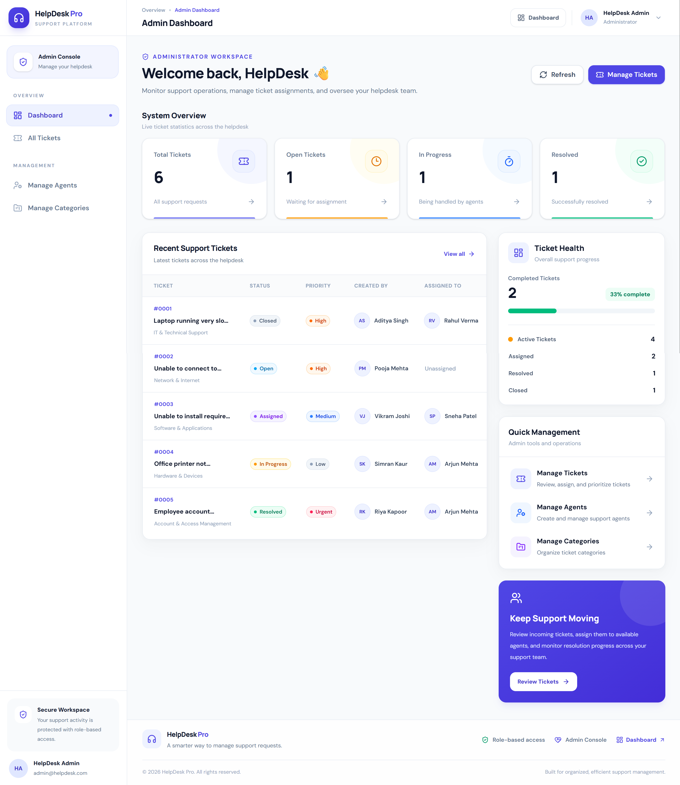

#### 2. All Tickets

Centralized ticket listing with status, priority, category, and pagination filters.

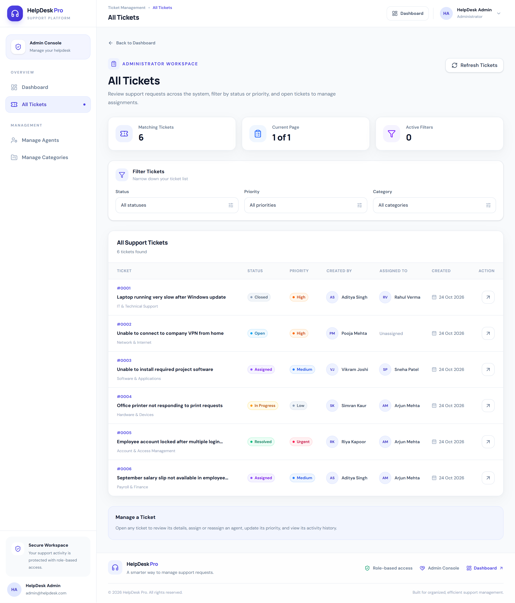

#### 3. Manage Agents

Create support agents and manage active or disabled agent accounts.

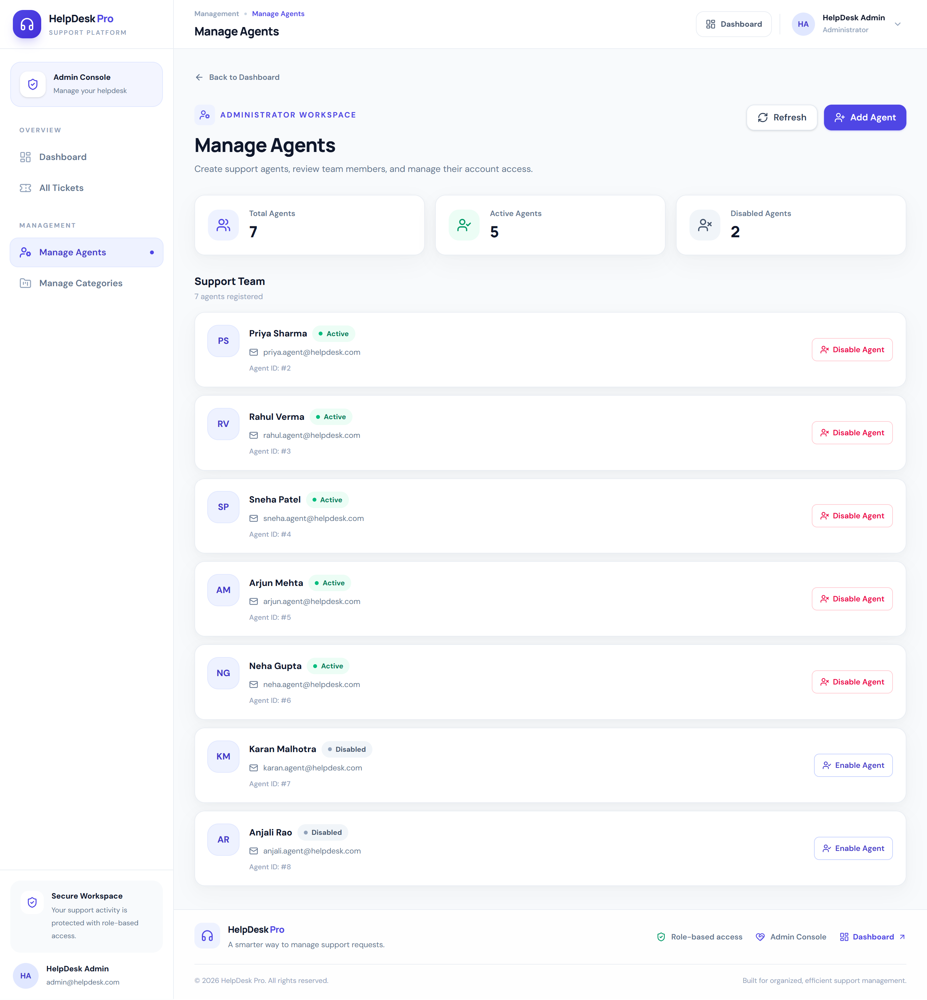

#### 4. Manage Categories

Create, update, enable, and disable support ticket categories.

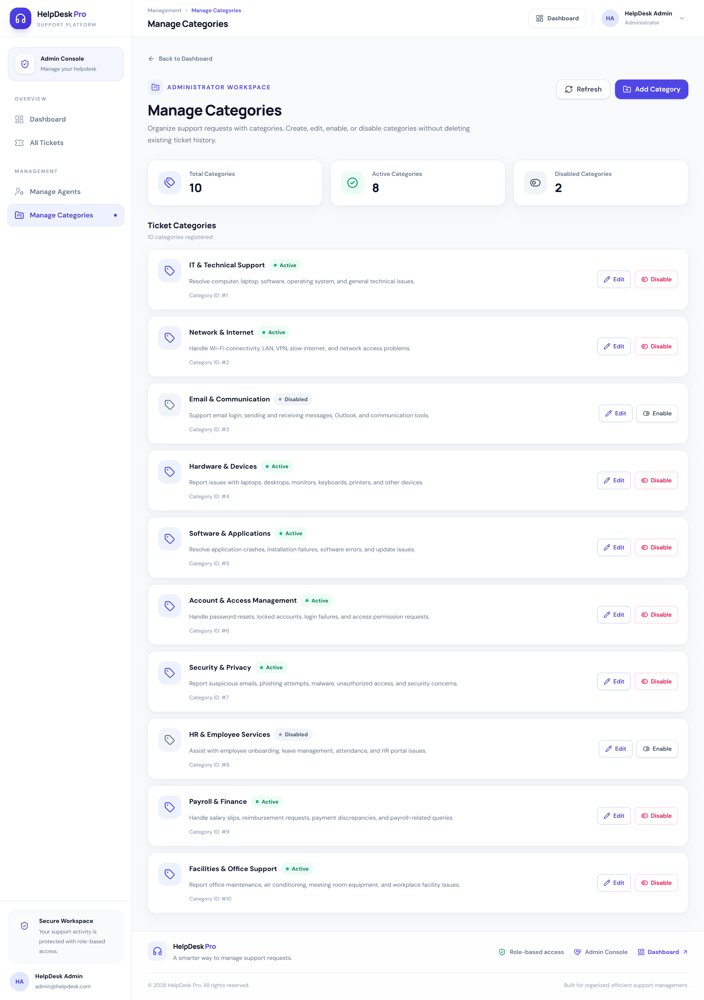

#### 5. Ticket Details & Activity History

View ticket information, assign or reassign agents, update priority, and review activity history.

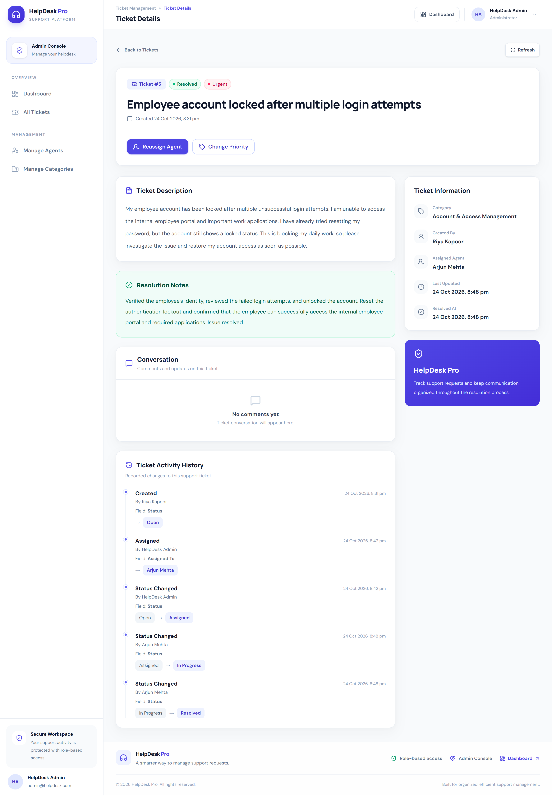

### 🧑‍💻 Agent Panel

#### 6. Agent Dashboard

Role-specific dashboard showing assigned ticket workload and progress.

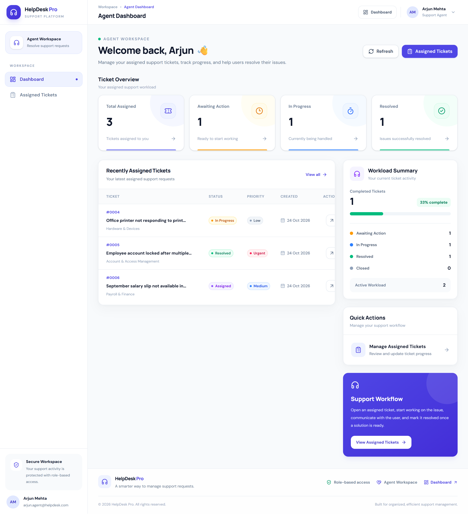

#### 7. Assigned Tickets

View and manage tickets assigned to the authenticated support agent.

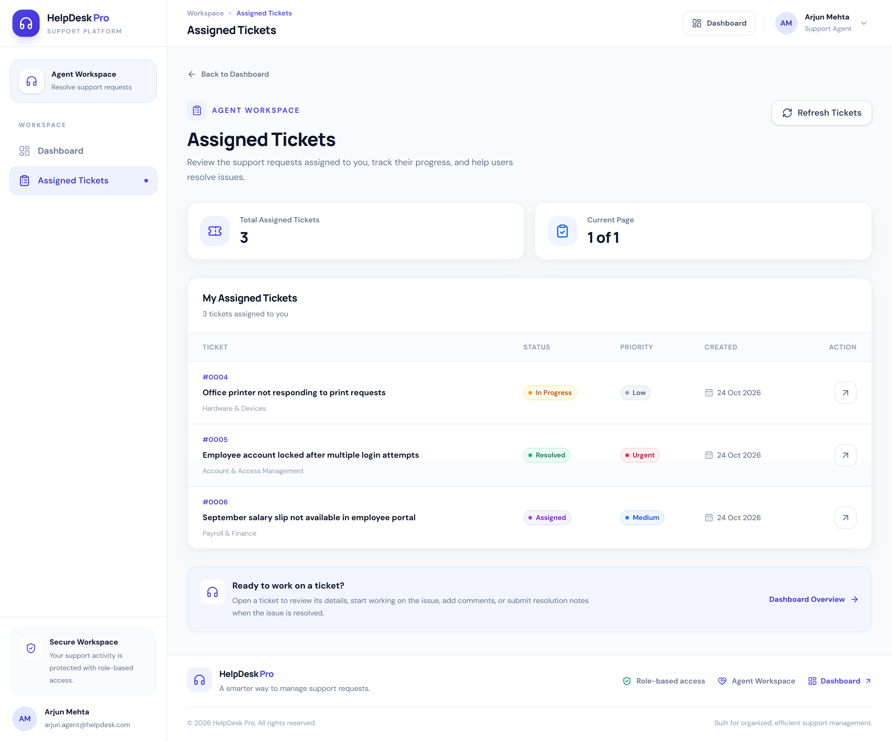

#### 8. Agent Ticket Details

Work on tickets, add comments, and submit resolution notes.

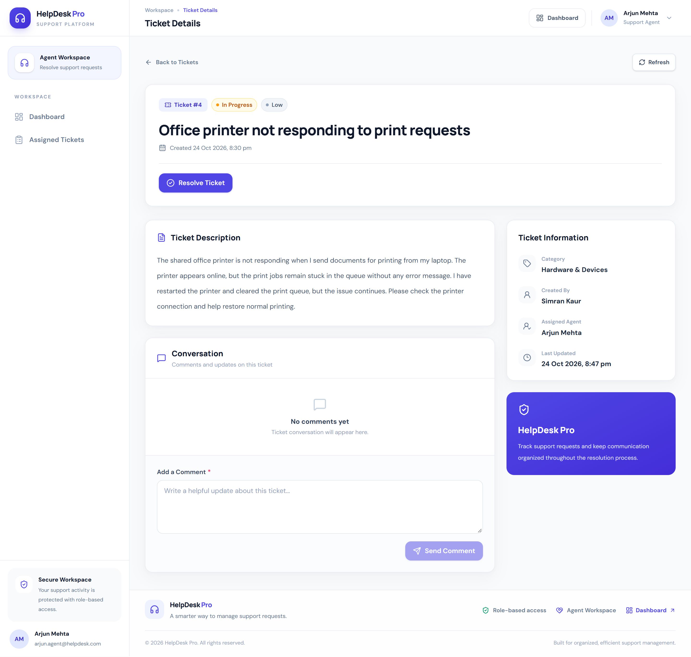

### 👤 User Panel

#### 9. User Dashboard

Personal dashboard showing the user's ticket statistics and recent requests.

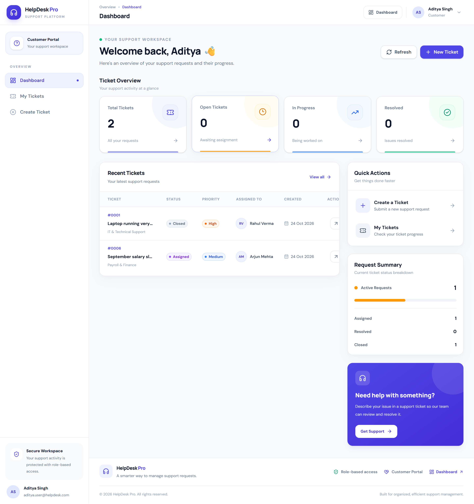

#### 10. My Tickets

View submitted tickets and track their current statuses.

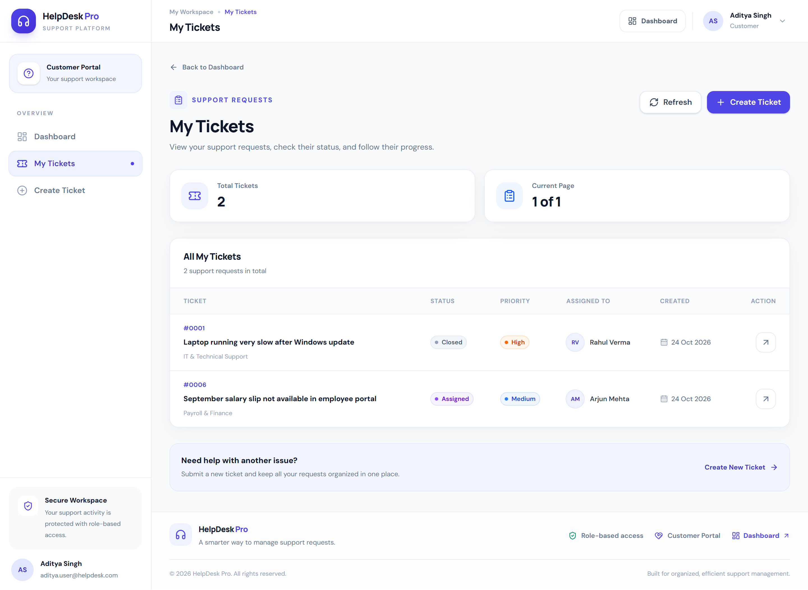

#### 11. Create Ticket

Submit a new support request with a title, description, category, and priority.

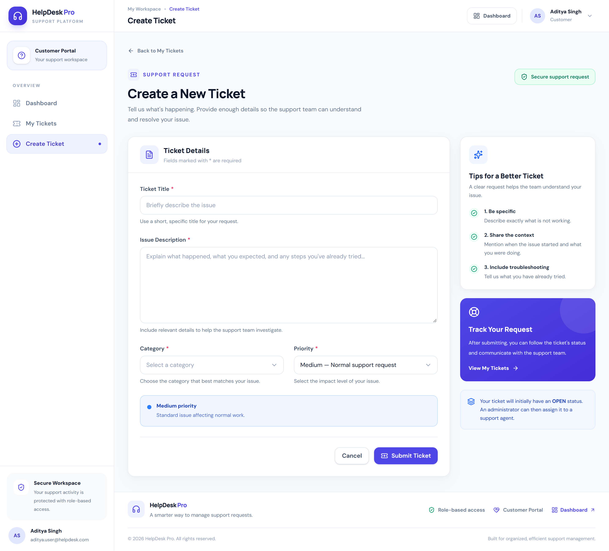

---

## ✨ Key Features

### 🔐 Authentication & Authorization

- User registration and login
- Spring Security authentication
- Session-based authentication using cookies
- CSRF protection for state-changing requests
- Password hashing
- Role-based access control
- Protected React routes
- Secure logout
- Backend authorization checks

### 🛡️ Admin Features

- View administrator dashboard
- View all support tickets
- Filter tickets by status, priority, and category
- View paginated ticket lists
- Assign tickets to support agents
- Reassign tickets to different agents
- Change ticket priority
- View ticket activity history
- Create agent accounts
- Enable or disable agent accounts
- View active and disabled agents
- Create support categories
- Update category information
- Enable or disable categories

### 🧑‍💻 Agent Features

- View agent dashboard
- View assigned tickets
- Access ticket details
- Start working on assigned tickets
- Change ticket status to IN_PROGRESS
- Add ticket comments
- Resolve tickets with resolution notes
- View customer communication

### 👤 User Features

- Register a new account
- Log in and log out
- View personal dashboard
- Create support tickets
- Choose ticket category and priority
- View submitted tickets
- Track ticket status
- View assigned support agent
- Add comments to own tickets
- Read agent responses
- Reopen resolved tickets
- Close resolved tickets

---

## 🛠️ Tech Stack

| Layer | Technologies |
|---|---|
| Backend | Java 21, Spring Boot |
| Security | Spring Security, Session Authentication, CSRF |
| Database | MySQL |
| ORM | Spring Data JPA, Hibernate |
| Build Tool | Maven |
| Frontend | React, JavaScript, JSX |
| Routing | React Router |
| Styling | Tailwind CSS v4 |
| Icons | Lucide React |
| API Integration | Native Fetch API |
| Frontend Build Tool | Vite |
| API Style | REST |

**Implementation notes:**

- No Lombok dependency is required.
- Frontend API requests use native `fetch` rather than Axios.
- React Context manages authentication and toast notifications.
- React Router provides role-based navigation.
- The backend enforces ticket ownership and assignment restrictions.

---

## 🏗️ System Architecture

```text
                      WEB BROWSER
                           |
                           v
                  React + Vite Frontend
                           |
                    REST API Requests
                    Session Cookies
                      CSRF Tokens
                           |
                           v
                    Spring Boot API
                           |
                     Spring Security
                           |
                       Controllers
                           |
                        Services
                           |
                      Repositories
                           |
                           v
                      MySQL Database
```

### Architecture Highlights

1. **Frontend:** React provides dashboards, forms, ticket tables, and ticket details.
2. **API Layer:** Spring Boot exposes REST endpoints.
3. **Security:** Spring Security handles authentication, authorization, and CSRF protection.
4. **Business Logic:** Service-layer rules control assignments, ticket transitions, and access.
5. **Persistence:** Spring Data JPA and Hibernate interact with MySQL.

---

## 👥 Role-Based Permissions

| Feature | Admin | Agent | User |
|---|:---:|:---:|:---:|
| View role dashboard | ✅ | ✅ | ✅ |
| Create ticket | ❌ | ❌ | ✅ |
| View all tickets | ✅ | ❌ | ❌ |
| View assigned tickets | ❌ | ✅ | ❌ |
| View own tickets | ❌ | ❌ | ✅ |
| Assign / reassign agents | ✅ | ❌ | ❌ |
| Change ticket priority | ✅ | ❌ | ❌ |
| Start ticket work | ❌ | ✅ | ❌ |
| Resolve ticket | ❌ | ✅ | ❌ |
| Reopen resolved ticket | ❌ | ❌ | ✅ |
| Close resolved ticket | ❌ | ❌ | ✅ |
| Add ticket comments | ❌ | ✅* | ✅* |
| Manage agents | ✅ | ❌ | ❌ |
| Manage categories | ✅ | ❌ | ❌ |
| View ticket activity history | ✅ | ❌ | ❌ |

*Comment permissions depend on ticket ownership, assignment, and status.*

---

## 🔄 Ticket Lifecycle

HelpDesk Pro follows a controlled support ticket workflow.

```text
                  USER CREATES TICKET
                           |
                           v
                         OPEN
                           |
                    Admin Assigns
                           |
                           v
                       ASSIGNED
                           |
                     Agent Starts
                           |
                           v
                     IN_PROGRESS
                           |
                    Agent Resolves
                           |
                           v
                       RESOLVED
                       /      \
                      /        \
              User Reopens   User Closes
                   |             |
                   v             v
              IN_PROGRESS      CLOSED
                   |
              Agent Resolves
                   |
                   v
                RESOLVED
```

### Ticket Statuses

| Status | Description |
|---|---|
| OPEN | Newly created ticket awaiting assignment |
| ASSIGNED | Ticket assigned to a support agent |
| IN_PROGRESS | Agent is actively working on the issue |
| RESOLVED | Agent has submitted a resolution |
| CLOSED | User has closed the resolved ticket |

### Ticket Priorities

- `LOW`
- `MEDIUM`
- `HIGH`
- `URGENT`

### Workflow Rules

- Only admins can assign or reassign agents.
- Only assigned agents can start and resolve tickets.
- Resolution notes are required when resolving tickets.
- Only the ticket creator can reopen or close a resolved ticket.
- Reopening moves a ticket from `RESOLVED` to `IN_PROGRESS`.
- Closed tickets cannot be reopened through the normal workflow.

---

## 📁 Project Structure

```text
HelpDesk-Pro/
│
├── backend/
│   ├── src/
│   │   ├── main/
│   │   │   ├── java/
│   │   │   └── resources/
│   │   └── test/
│   └── pom.xml
│
├── frontend/
│   ├── public/
│   ├── src/
│   │   ├── components/
│   │   │   ├── auth/
│   │   │   ├── dashboard/
│   │   │   ├── layout/
│   │   │   ├── tickets/
│   │   │   └── ui/
│   │   ├── context/
│   │   ├── lib/
│   │   ├── pages/
│   │   │   ├── admin/
│   │   │   ├── agent/
│   │   │   ├── auth/
│   │   │   ├── tickets/
│   │   │   └── user/
│   │   ├── App.jsx
│   │   ├── main.jsx
│   │   └── index.css
│   ├── package.json
│   └── vite.config.js
│
├── database/
│   └── helpdesk_schema.sql
│
├── screenshots/
│   ├── 01-admin-dashboard.png
│   ├── 02-admin-all-tickets.png
│   ├── 03-admin-manage-agents.png
│   ├── 04-admin-categories.png
│   ├── 05-admin-ticket-details.png
│   ├── 06-agent-dashboard.png
│   ├── 07-agent-ticket.png
│   ├── 08-agent-ticket-details.png
│   ├── 09-user-dashboard.png
│   ├── 10-user-my-tickets.png
│   └── 11-user-create-ticket.png
│
├── .gitignore
└── README.md
```

---

## 🗄️ Database Setup

HelpDesk Pro uses **MySQL** for persistent storage.

### Step 1: Create the Database

Open MySQL Workbench or the MySQL command-line client.

```sql
CREATE DATABASE IF NOT EXISTS helpdesk_db;
```

### Step 2: Import the Schema

The database schema is stored in:

```text
database/helpdesk_schema.sql
```

Import it using MySQL CLI:

```bash
mysql -u root -p helpdesk_db < database/helpdesk_schema.sql
```

Alternatively, open the SQL file in MySQL Workbench and execute it against the `helpdesk_db` database.

**Note:** Export the schema from the actual project database using a structure-only export. Do not include real user records, password hashes, sessions, or private ticket information.

### Step 3: Configure Database Connection

Configure the Spring Boot datasource for your local MySQL installation.

Example:

```properties
spring.datasource.url=jdbc:mysql://localhost:3306/helpdesk_db
spring.datasource.username=${DB_USERNAME}
spring.datasource.password=${DB_PASSWORD}
```

Set the required environment variables before starting the backend.

Keep local passwords and credentials out of Git.

---

## 🚀 Getting Started

### Prerequisites

Install the following:

- Java JDK 21
- Maven
- Node.js and npm
- MySQL Server
- Git

### 1. Clone the Repository

```bash
git clone https://github.com/brahamkumar002/HelpDesk-Pro.git
cd HelpDesk-Pro
```

Replace `brahamkumar002` with your GitHub username.

### 2. Set Up MySQL

Create `helpdesk_db` and import the schema as described in the Database Setup section.

Configure the backend datasource and any required environment variables.

### 3. Run the Backend

Open a terminal:

```bash
cd backend
mvn spring-boot:run
```

Default backend URL:

```text
http://localhost:8080
```

### 4. Run the Frontend

Open another terminal:

```bash
cd frontend
npm install
npm run dev
```

Default frontend URL:

```text
http://localhost:5173
```

### 5. Open the Application

Visit:

```text
http://localhost:5173
```

Register a user account or sign in using an account provisioned in the backend.

**Important:** Admin and agent accounts are managed separately from public user registration. Never commit administrator credentials or demo passwords.

---

## 🔌 REST API Documentation

The backend exposes REST endpoints under `/api`.

### Authentication APIs

| Method | Endpoint | Description |
|---|---|---|
| GET | `/api/auth/csrf` | Get CSRF token |
| POST | `/api/auth/register` | Register a user |
| POST | `/api/auth/login` | Log in |
| GET | `/api/auth/me` | Get authenticated user |
| POST | `/api/auth/logout` | Log out |

### Ticket APIs

| Method | Endpoint | Description |
|---|---|---|
| POST | `/api/tickets` | Create ticket |
| GET | `/api/tickets/my` | View user's tickets |
| GET | `/api/tickets/assigned` | View agent's assigned tickets |
| GET | `/api/tickets/all` | View all tickets (Admin) |
| GET | `/api/tickets/{id}` | View ticket details |
| PATCH | `/api/tickets/{id}/assign` | Assign / reassign agent |
| PATCH | `/api/tickets/{id}/priority` | Change ticket priority |
| PATCH | `/api/tickets/{id}/start` | Start ticket work |
| PATCH | `/api/tickets/{id}/resolve` | Resolve ticket |
| PATCH | `/api/tickets/{id}/reopen` | Reopen ticket |
| PATCH | `/api/tickets/{id}/close` | Close ticket |
| GET | `/api/tickets/{id}/history` | View activity history |

### Ticket Comments APIs

| Method | Endpoint | Description |
|---|---|---|
| GET | `/api/tickets/{ticketId}/comments` | View ticket comments |
| POST | `/api/tickets/{ticketId}/comments` | Add ticket comment |

### Category APIs

| Method | Endpoint | Description |
|---|---|---|
| GET | `/api/categories` | Get enabled categories |
| GET | `/api/categories/all` | Get all categories (Admin) |
| POST | `/api/categories` | Create category |
| PUT | `/api/categories/{id}` | Update category |
| PATCH | `/api/categories/{id}/enable` | Enable category |
| PATCH | `/api/categories/{id}/disable` | Disable category |

### Agent Management APIs

| Method | Endpoint | Description |
|---|---|---|
| GET | `/api/admin/agents` | Get all agents |
| GET | `/api/admin/agents/enabled` | Get enabled agents |
| POST | `/api/admin/agents` | Create agent |
| PATCH | `/api/admin/agents/{id}/enable` | Enable agent |
| PATCH | `/api/admin/agents/{id}/disable` | Disable agent |

### Dashboard API

| Method | Endpoint | Description |
|---|---|---|
| GET | `/api/dashboard` | Get role-specific dashboard statistics |

---

## 🔒 Security

The application uses Spring Security to protect backend resources.

### Security Features

- Session-based authentication
- CSRF token validation
- Role-based authorization
- Password hashing
- Protected API endpoints
- Ticket ownership checks
- Agent assignment checks
- Admin-only management operations
- Restricted ticket status transitions
- Disabled agent account support

### Access Control Rules

- Users can access only their own tickets.
- Agents can access only tickets assigned to them.
- Admins can manage tickets, agents, and categories.
- Agents cannot directly close customer tickets.
- Users cannot directly resolve tickets.
- Only the ticket creator can close or reopen their resolved ticket.
- Closed tickets cannot be modified through the normal workflow.

Frontend route guards improve navigation and user experience, while backend authorization enforces security.

---

## 🧪 Testing

HelpDesk Pro has been manually tested through the React frontend integrated with the Spring Boot backend.

### Verified Workflows

- User registration and login
- Admin and agent login
- Ticket creation
- Ticket assignment and reassignment
- Ticket priority updates
- Ticket filtering
- Agent ticket processing
- Ticket comments
- Resolution with notes
- Ticket reopening
- Ticket closure
- Activity history
- Agent creation and disabling
- Category management
- Role-specific dashboards
- Role-based navigation and access restrictions

---

## 📚 What I Learned

This project provided practical experience with:

- Java backend development
- Spring Boot REST API architecture
- Spring Security authentication and authorization
- Role-based access control
- MySQL database integration
- Spring Data JPA and Hibernate
- React components and hooks
- React Context API
- React Router
- Native Fetch API
- Responsive UI development
- Ticket lifecycle state management
- Full-stack debugging and integration testing

---

## 🔮 Future Enhancements

Potential future improvements:

- Email notifications
- Ticket file attachments
- SLA tracking and escalation
- Advanced analytics and reporting
- Full-text ticket search
- Password reset functionality
- User profile management
- Docker deployment
- Automated integration and end-to-end tests

These are future improvements, not currently implemented features.

---

## 👨‍💻 About the Project

**HelpDesk Pro** is a full-stack portfolio project developed to demonstrate practical Java, Spring Boot, React, and MySQL skills through a real-world helpdesk support workflow.

It focuses on clean architecture, role-based security, maintainable code, and frontend-backend integration.

---

## 📄 License

No open-source license has been specified for this repository.
